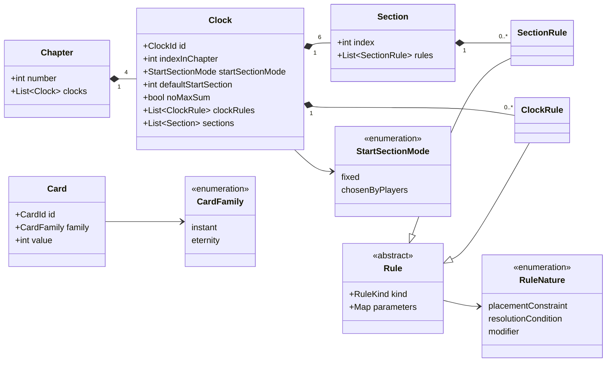
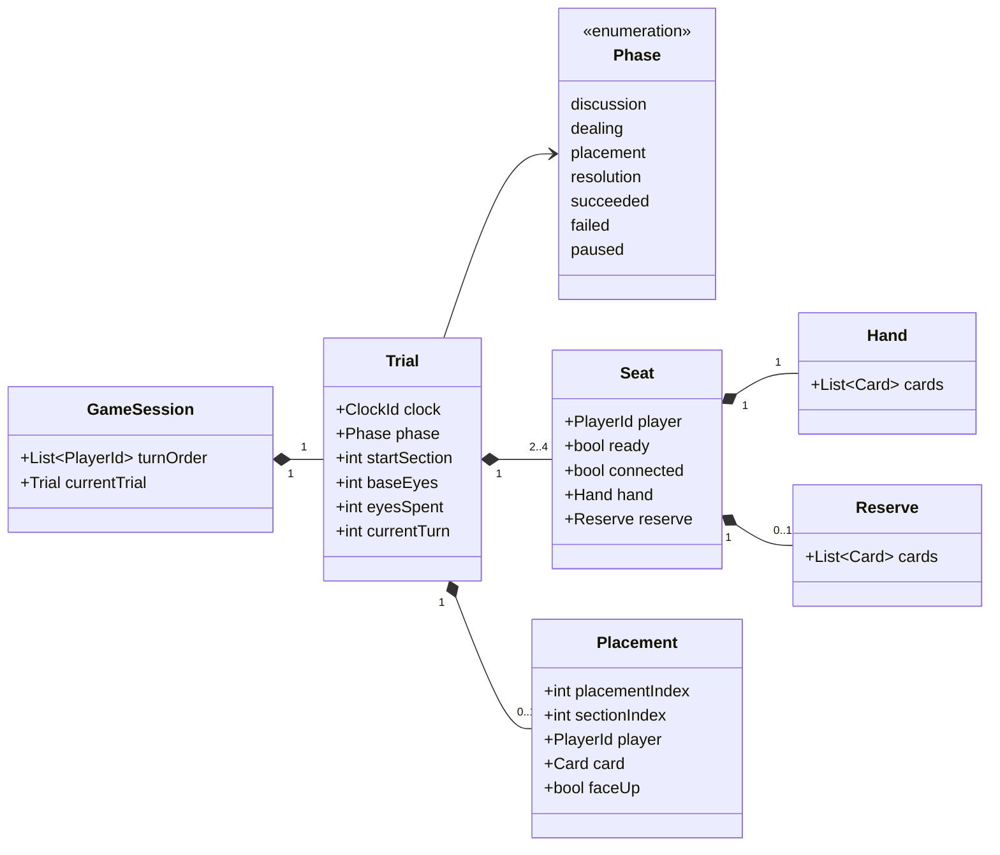
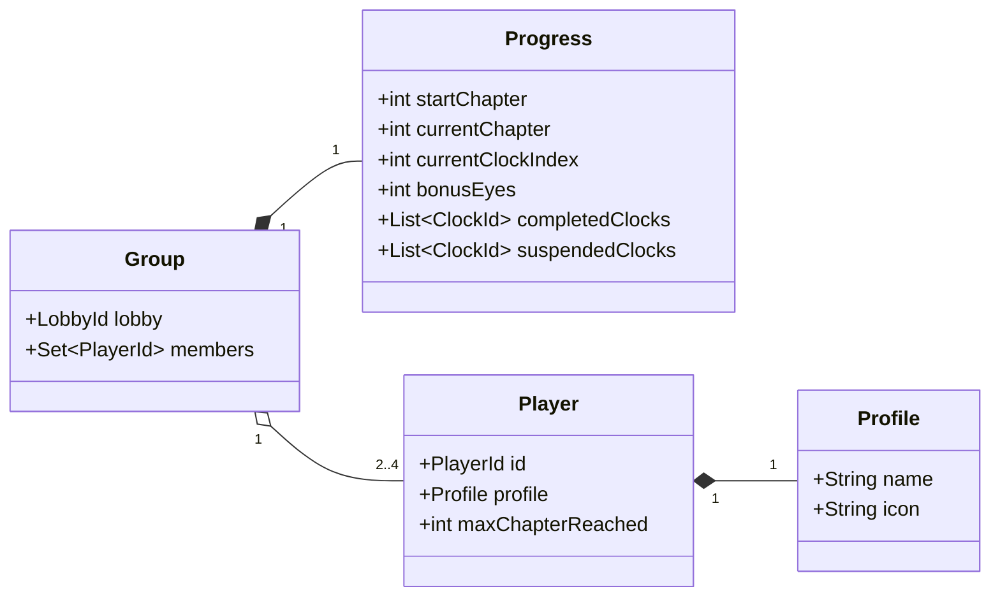

# Modèle du domaine

Entités du jeu et leurs relations. Ce diagramme décrit le métier, pas l'implémentation : pas de base de données, pas de réseau, pas de méthodes techniques. Les noms suivent le [glossaire](../glossary.md).

## Définition du contenu

Ce qui décrit le jeu lui-même. Ces données sont fixes et identiques pour tous les groupes.

## État d'une épreuve

Ce qui change pendant qu'un groupe joue.

## Progression

Ce qui est conservé entre deux parties.

## Décisions de modélisation

- **Le groupe** est identifié par sa salle. Ses membres forment un ensemble fixe : une progression ne reprend qu'avec exactement les mêmes joueurs.
- **Les yeux bonus** survivent aux épreuves et aux sessions sauvegardées : ils font partie de la progression du groupe, pas de l'épreuve.
- **Le chapitre maximum** d'un joueur vit sur le joueur, puisqu'il se calcule toutes salles confondues.
- **L'identifiant de carte** (`CardId`) est tiré au hasard à chaque distribution. Un identifiant stable comme `instant-12` donnerait la valeur à quiconque le lit.
- **La section de départ** est une donnée de l'épreuve, puisqu'elle peut être choisie par les joueurs à partir du chapitre 3. L'horloge ne fournit que sa valeur par défaut.

## Vue d'un joueur

Les classes ci-dessus décrivent l'état complet, que seul le serveur connaît. Chaque joueur reçoit une projection de cet état, où les informations qu'il n'a pas le droit de connaître sont absentes : une `Placement` posée face cachée par un autre joueur n'y contient que la famille de la carte, pas sa valeur. Les classes de cette vue appartiennent à `packages/protocol`, pas au domaine.
