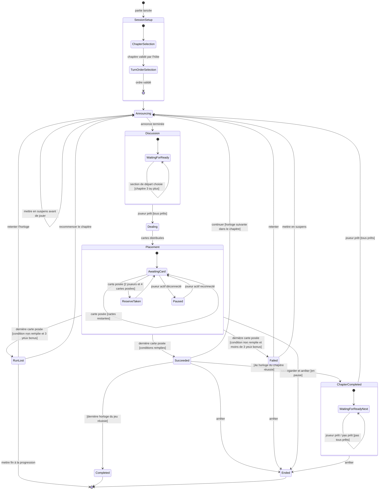

# Cycle de vie d'une partie

Machine à états de la partie côté serveur. Chaque état répond à la question « la partie est actuellement… ». Les transitions sont étiquetées par l'événement qui les déclenche, avec une garde entre crochets quand une condition s'applique.

Les décisions après une épreuve (continuer, retenter, mettre en suspens, arrêter) sont des commandes réservées à l'hôte.

## Effets attachés aux transitions

| Transition                    | Effets                                                                                                                               |
| ----------------------------- | ------------------------------------------------------------------------------------------------------------------------------------ |
| Vers `ChapterSelection`       | Calcul du chapitre maximum autorisé : le plus petit des chapitres maximum atteints par les joueurs présents.                         |
| Vers `Announcing`             | Calcul des yeux disponibles. Statuts « prêt » remis à zéro. Section de départ fixée par l'horloge jusqu'au chapitre 2.               |
| `section de départ choisie`   | Section de départ enregistrée dans l'épreuve. Statuts « prêt » remis à zéro.                                                         |
| Vers `Dealing`                | Mélange avec une graine, distribution selon le nombre de joueurs. Chaque joueur reçoit sa main, et la famille des cartes des autres. |
| Vers `Placement`              | Le tour passe au premier joueur de l'ordre de passage.                                                                               |
| `carte posée`                 | Validation des contraintes de pose, décompte de l'œil si face visible, passage au joueur suivant.                                    |
| Vers `ReserveTaken`           | En partie à 2, chaque joueur reçoit la valeur de sa réserve.                                                                         |
| Vers `Paused`                 | Message à tous indiquant le joueur absent.                                                                                           |
| Vers `Succeeded`              | Yeux bonus remis à zéro, progression sauvegardée, chapitre maximum des joueurs mis à jour.                                           |
| Vers `Failed`                 | Un œil bonus gagné.                                                                                                                  |
| Vers `RunLost`                | L'hôte choisit la suite.                                                                                                             |
| `recommencer le chapitre`     | Retour à la première horloge du chapitre, yeux bonus remis à zéro.                                                                   |
| `mettre fin à la progression` | Progression du groupe supprimée.                                                                                                     |
| `mettre en suspens`           | Horloge ajoutée aux horloges en suspens, yeux bonus remis à zéro, progression sauvegardée.                                           |
| Vers `Ended`                  | Progression sauvegardée.                                                                                                             |

## Ce que ce diagramme ne montre pas

- **Les commandes refusées.** Une commande invalide dans l'état courant (poser une carte pendant la Discussion, une décision d'hôte envoyée par un autre joueur) est rejetée sans changer l'état.
- **La présence des joueurs.** Les vérifications d'inactivité sont gérées au niveau de la salle (voir [le cycle de vie d'une salle](lobby-state.md)).
- **La Résolution.** Côté serveur, elle est instantanée : la dernière carte posée déclenche l'évaluation et le passage direct à `Succeeded`, `Failed` ou `RunLost`. La révélation section par section n'est qu'une animation du client.
- **Les déconnexions hors du tour du joueur.** Un joueur déconnecté pendant la Discussion ou pendant le tour d'un autre ne met pas la partie en pause. Elle ne s'arrête que quand son tour arrive.
