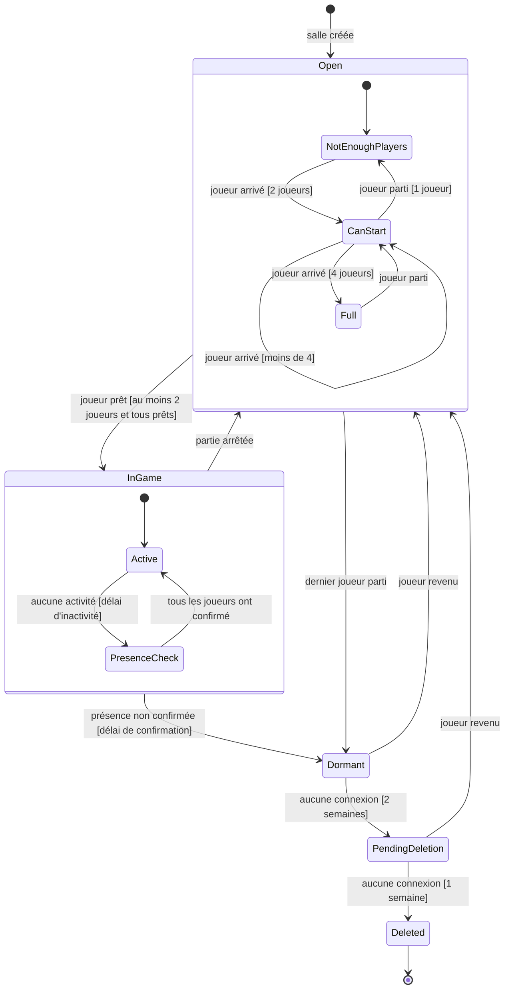

# Cycle de vie d'une salle

Machine à états d'une salle côté serveur. Une salle porte la progression de son groupe : elle survit à la fin d'une session de jeu et n'est supprimée qu'après une longue inactivité.

## Délais

Tous les délais sont des paramètres de configuration, pour pouvoir les ajuster après les parties de test (exigence NF-OPS-03).

| Paramètre | Valeur initiale | Rôle |
|-----------|-----------------|------|
| `inactivityDelay` | 2 min | Durée sans activité avant la vérification de présence. |
| `inactivityDelayDiscussion` | 5 min | Même délai, pendant la Discussion. |
| `presenceConfirmationDelay` | 1 min | Temps laissé à chaque joueur pour confirmer sa présence. |
| `dormantDeletionWarningDelay` | 2 semaines | Durée sans connexion avant l'avertissement de suppression. |
| `deletionDelay` | 1 semaine | Durée entre l'avertissement et la suppression. |

## Règles associées

| Événement | Règle |
|-----------|-------|
| Arrivée d'un joueur | Refusée si la salle est pleine ou en jeu, sauf pour un joueur qui faisait partie de la partie en cours. |
| Lancement d'une partie | Pour reprendre la progression de la salle, les joueurs présents doivent être exactement ceux du groupe. |
| Départ de l'hôte | Le rôle d'hôte passe au joueur arrivé le plus tôt. |
| Départ d'un joueur | Les statuts « prêt » de tous les joueurs sont remis à zéro. |
| Passage en `Dormant` | La session en cours est sauvegardée. |
| Avertissement | Un e-mail est envoyé à chaque joueur du groupe. |
| Suppression | La progression du groupe est supprimée et le code de salle est libéré. |
| Nouveau joueur | Un groupe qui accueille un nouveau joueur forme un nouveau groupe, avec une nouvelle progression. |

## Questions ouvertes

- **L'activité.** Qu'est-ce qui compte comme activité ? Une commande d'un joueur, un message de chat, un mouvement de souris ?
