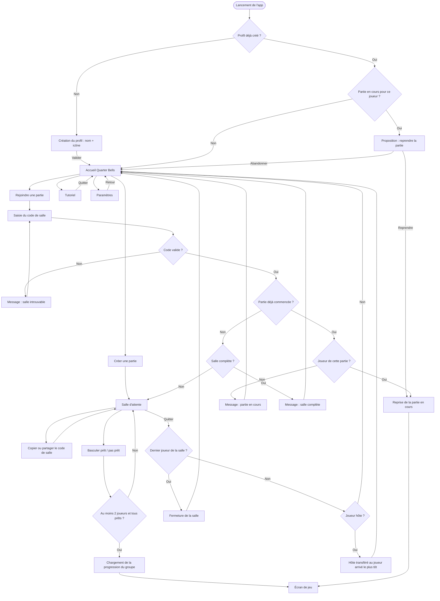

# Navigation du client

Parcours de l'utilisateur entre les écrans, du lancement de l'app à l'entrée en partie.

## Notes

- La reprise est proposée automatiquement au lancement si le joueur a une partie en cours. La saisie du code reste possible pour un joueur qui a changé d'appareil.
- Le transfert d'hôte et la fermeture de salle sont des effets côté serveur. Ils figurent ici pour montrer ce que le joueur qui part ne voit pas : les autres joueurs restent dans la salle avec un nouvel hôte.
